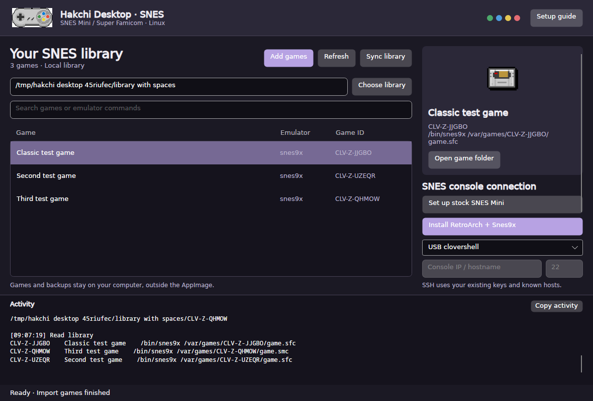

# Hakchi Desktop for Linux

The AppImage opens a native Avalonia window when launched without arguments.
The SNES desktop uses the existing Hakchi CLI for operations. Its dark purple
theme, SNES controller and Super Famicom button colors identify the SNES profile.
New settings default to `snes9x`; selecting `.sfc`/`.smc` ROMs selects it even when
older preferences contain a NES emulator. Other saved libraries remain available.

The maintainer confirms the SNES Mini workflow is fully working on a real console:
stock Hakchi setup, RetroArch/Snes9x installation, game sync and game launch
(10 October 2026). Automated tests validate the frontend and packaging separately.
This report covers that workflow and console, not every game or model.

The SNES theme and bundled emulator action require a build of current `mainline`
source. The v0.3.0 download below predates these changes.



Desktop v0.3.0 includes the stock SNES installer described below. Earlier
releases predate it.

Download the [experimental desktop release](https://github.com/dazeb/Hakchi2-CE/releases/tag/linux-desktop-v0.3.0)
and its checksum, then run:

```sh
sha256sum -c hakchi-linux-x64.AppImage.sha256
chmod +x hakchi-linux-x64.AppImage
./hakchi-linux-x64.AppImage
```

You can also open it from your file manager. If FUSE is unavailable:

```sh
./hakchi-linux-x64.AppImage --appimage-extract-and-run
```

Use a glibc-based Linux desktop with X11 or XWayland, fontconfig and the standard
.NET native dependencies (ICU and OpenSSL). The release is built on Debian 12.
The AppImage includes .NET, Avalonia, native rendering and USB libraries, payloads
and license notices. It does not require Wine or a system .NET installation.

On Debian/Ubuntu, the desktop prerequisites include:

```sh
sudo apt install libx11-6 libice6 libsm6 libfontconfig1 openssh-client
```

## Prepare a library

1. Choose a local library directory, or use the default under your XDG data directory.
2. Select **Add games** and choose `.sfc`/`.smc` ROM files. The SNES ROM filter and
   `snes9x` command are selected by default. You can choose other ROM types and
   installed emulator commands. A single game can have a custom name;
   multiple games use their filenames.
3. Search the library and select a game to preview its artwork, ID and command.
   Importing and browsing work without a console. Duplicate or invalid inputs appear
   in Activity; already imported games are retained if a later import fails.

The frontend adds the backend's default artwork. Automatic artwork search, game
patching, SFROM conversion and custom folder generation remain outside this port.

## Connect and synchronize

For USB clovershell, install the bundled USB permissions rule as described in the
[CLI setup guide](../hakchi_cli/README.md#appimage), reconnect the console and choose
**USB clovershell**. **Find USB devices** checks USB enumeration; it does not prove
that your console is running a shell.

For SSH, select **SSH / network**, enter the console hostname/IP and port. Install
OpenSSH and configure your existing SSH key/agent. Connect once from a terminal to
approve a new host key or resolve authentication:

```sh
ssh -p 22 root@CONSOLE_IP
```

GUI operations run OpenSSH in batch mode. They show authentication errors instead
of waiting for an invisible password/host-key prompt. Passwords and private keys
are not stored in the frontend's settings.

Use **Check status** to inspect firmware/storage. Set **Console game storage** to
the actual writable game path returned by the console before synchronizing.
**Sync library** asks for confirmation and uploads the entire chosen library
to menu `000`. Existing copies of those game IDs are replaced; other games and saves
are preserved. The library search filters the view, not the synchronization set.

**Install RetroArch + Snes9x** installs the bundled modules in that order, then
checks their console launcher and core files. Set up Hakchi and save your backup
first. Installation replaces these emulator files and default configuration;
both package hashes are checked before connecting. Import SNES games with `snes9x`,
synchronize, then launch a game on the console. See the [bundled module guide](../hakchi_cli/modules/README.md).

**Install module** selects another `.hmod` file and confirms installation.
**Save backup** retrieves a stock-kernel backup already held by compatible firmware;
it does not create a stock backup from an unmodified console.

Operations show their output and errors in Activity. Controls are disabled while
an operation runs, and the window waits for it to finish before closing. Remote
commands use the CLI's 30-second timeout. Raw FEL flashing remains in the CLI.

## Stock SNES setup

**Set up stock SNES Mini** opens the first-installation dialog. It guides FEL
recovery boot, USB networking/SSH approval, private original-kernel backup,
stock-model identification, explicit installation and post-install verification.
The firmware and base modules are bundled in newly built AppImages. See the
[stock console workflow](../hakchi_cli/README.md#if-the-console-is-stock-or-needs-first-time-installation)
for connection details and the equivalent CLI commands. This installer accepts
recognized stock SNES Mini/Super Famicom kernels only. The maintainer confirms
installation on their SNES Mini.

Backups default to `$XDG_DATA_HOME/hakchi/backups` or `~/.local/share/hakchi/backups`.
Keep the backup directory for recovery. The dialog cannot close during an active
operation, and an SSH disconnect never counts as confirmed installation success.

## Settings and shortcuts

- Library: `$XDG_DATA_HOME/hakchi/games`, or `~/.local/share/hakchi/games`.
- Settings: `$XDG_CONFIG_HOME/hakchi/preferences.json`, or `~/.config/hakchi/preferences.json`.
- Games, backups and preferences stay outside the AppImage; moving/updating it retains them.
- `Ctrl+F`: search. `Ctrl+L`: edit the library location. `F5`: refresh.
- `Ctrl+O`: add game ROMs.
- `Ctrl+Shift+S`: set up a stock SNES Mini. `Escape` closes idle setup.
- `Ctrl+Shift+M`: install bundled RetroArch/Snes9x modules.
- `Ctrl+Shift+C`: copy Activity for troubleshooting.

## Terminal commands and source builds

Explicit command arguments still run the CLI:

```sh
./hakchi-linux-x64.AppImage --help
./hakchi-linux-x64.AppImage game-list ./games
./hakchi-linux-x64.AppImage --host CONSOLE_IP status
./hakchi-linux-x64.AppImage --gui
```

The [CLI guide](../hakchi_cli/README.md) covers transfers, modules and FEL recovery.
Build the complete desktop AppImage with `bash hakchi_cli/appimage.sh`; this publishes
both .NET 10 projects and packages their dependency notices. The builder needs the
SDK, NuGet access and the dependencies listed in the CLI packaging guide. Initialize
`Libraries/FelLib` when building a Git checkout. The release source archive already
includes it.

Verify the frontend adapter and the actual packaged window:

```sh
dotnet run --project hakchi_frontend/tests/FrontendTests.csproj -c Release
APPIMAGE_EXTRACT_AND_RUN=1 xvfb-run -a python3 hakchi_frontend/tests/test_desktop.py \
  --binary hakchi_cli/bin/appimage/hakchi-linux-x64.AppImage
```

The desktop smoke test uses Xvfb, xdotool, xclip and ImageMagick. It starts the default
AppImage entry point, reads a prepared library through the real CLI, exercises
search/refresh and invalid-location recovery, imports a ROM through the file picker
and settings dialog, and saves screenshots when requested.

The SNES Mini workflow has maintainer-confirmed hardware results. Other consoles,
low-level flashing and ARM64 remain unvalidated. First-time installation for
other console families, factory reset and storage expansion are not automated.
This frontend does not provide full Windows GUI feature parity.
